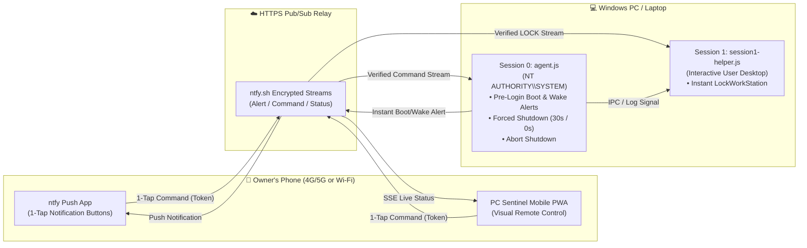

# 🛡️ PC Sentinel — Pre-Login Boot Tracker & 1-Tap Remote Shutdown Agent

**PC Sentinel** is a lightweight, zero-dependency Node.js security & remote control agent for Windows laptops and desktops. It sends an **instant push notification to your phone the exact moment your PC turns on**—even while sitting at the **Windows Password / Lock Screen (before login)**—and lets you **shut down** (`30s` countdown or `0s` instant), **abort shutdown**, or **lock the screen** with **one tap** from anywhere in the world (Wi-Fi or 4G/5G mobile data).

---

## ✨ Key Features

- **⚡ Pre-Login Boot Detection (`NT AUTHORITY\SYSTEM`)**:
  Runs in **Windows Session 0** at system startup (`AtStartup`) so you get alerted on your phone *before* anyone enters a Windows password.
- **🌙 Fast Startup & Sleep/Hibernate Wake Detection**:
  Modern Windows laptops use Hybrid Sleep / Fast Startup instead of full cold boots. PC Sentinel hooks into Windows Event Log (`Power-Troubleshooter` Event ID `1` & `Kernel-Power` Event ID `107`) plus a real-time wall-clock jump detector to catch every wake-up immediately.
- **📶 Smart Wi-Fi Wait**:
  Automatically waits and retries at boot until Wi-Fi finishes connecting to the router before dispatching the alert.
- **📲 1-Tap Notification Actions (`ntfy`)**:
  Every push alert arrives on your phone with built-in 1-tap action buttons right on the notification banner:
  - `🛑 Shut Down (30s)` — Starts a forced 30-second shutdown (`shutdown.exe /s /f /t 30`).
  - `🔒 Lock Screen` — Immediately locks the active Windows desktop session.
  - `❌ Cancel Shutdown` — Aborts a pending shutdown countdown (`shutdown.exe /a`).
- **📱 Custom Mobile Web App (PWA)**:
  Includes a sleek dark-mode mobile controller (`pwa.html`) with live session state (`At Password Screen` vs `User Logged In`), system uptime, a 30-second countdown display, and 1-tap controls that work over **both local Wi-Fi (`http://<pc-ip>:4848`) and global 4G/5G cloud relay**.
- **🔐 Token-Authenticated Commands**:
  Auto-generates cryptographically random topic channels and a secret verification token (`config.json`) on first run. Any command without your secret token is rejected.

---

## 🏗️ How It Works (Windows Session 0 + Session 1 Architecture)



### Why Two Processes (`agent.js` + `session1-helper.js`)?
Windows enforces **Session 0 Isolation**:
1. **`agent.js` (Session 0 — `NT AUTHORITY\SYSTEM`)** runs *before* any user logs in. It detects pre-login boots, reports whether `LogonUI.exe` / `explorer.exe` is active, and executes system-wide commands like `shutdown.exe /s /f /t 30` and `shutdown.exe /a`.
2. **`session1-helper.js` (Session 1 — Interactive Desktop)** runs silently in the logged-in user's desktop session so that `rundll32.exe user32.dll,LockWorkStation` can lock the visible desktop instantaneously when `🔒 Lock Screen` is tapped on your phone.

---

## 📂 Project Structure

| File | Description |
| :--- | :--- |
| `agent.js` | Main background tracker & remote command server (runs at boot & serves port `4848`). |
| `session1-helper.js` | Interactive user-session companion that executes `LockWorkStation` in Session 1. |
| `pwa.html` | Custom Mobile App (PWA) UI supporting both local HTTP and global cloud relay via URL `#hash` / `localStorage`. |
| `init-config.js` | Generates `config.json` (random secret topics & token) and builds a standalone `PC-Sentinel-Phone-App.html`. |
| `install-service.ps1` | PowerShell installer that registers the Task Scheduler tasks (`AtStartup`, `AtLogOn`, and Wake Event ID `1`/`107`) + Windows Firewall rule. |
| `Enable-PreLogin-Service.bat` | One-click UAC administrator launcher for `install-service.ps1`. |
| `start-hidden.vbs` | Windowless VBScript launcher so Node.js runs completely invisibly with zero console popup. |
| `config.example.json` | Example template for `config.json` (actual `config.json` is gitignored to protect your token). |

---

## 🚀 Installation & Setup Guide

### Prerequisites
- **Windows 10 or Windows 11**
- **[Node.js](https://nodejs.org/)** installed (`C:\Program Files\nodejs\node.exe`)
- Free **[ntfy](https://ntfy.sh)** app installed on your phone ([Android Play Store](https://play.google.com/store/apps/details?id=io.heckel.ntfy) / [iOS App Store](https://apps.apple.com/us/app/ntfy/id1625396347))

### 1. Clone & Generate Your Secret Configuration
```powershell
git clone https://github.com/YeasinFiyaz/pc-sentinel-agent.git C:\Users\DFIT\PCTrackerAgent
cd C:\Users\DFIT\PCTrackerAgent
node init-config.js
```
This creates your private `config.json` with a unique `alertTopic`, `cmdTopic`, `statusTopic`, and `secretToken`.

### 2. Enable Pre-Login System Service (1-Click Admin Setup)
Double-click **`Enable-PreLogin-Service.bat`** and click **Yes** on the Windows UAC prompt.
This automatically:
1. Registers `PCSentinel_PreLoginBootAgent` as `NT AUTHORITY\SYSTEM` (`AtStartup` + `AtLogOn`).
2. Registers `PCSentinel_WakeFromSleepOrFastStartup` on Windows Event IDs `1` (`Power-Troubleshooter`) and `107` (`Kernel-Power`).
3. Opens port `4848` in Windows Firewall for local Wi-Fi PWA access.
4. Starts the background service immediately.

### 3. Connect Your Phone
1. Open `config.json` (or open `http://localhost:4848` on your PC) and copy your **`alertTopic`**.
2. In the **ntfy** app on your phone, tap **`+`** and subscribe to that `alertTopic`.
3. Tap the **`https://...`** Mobile Web App link inside the alert notification to open the visual **PC Sentinel** remote controller in Chrome/Safari and select **Add to Home Screen**.

---

## 🧪 Available Remote Commands

| Command | Action on PC |
| :--- | :--- |
| `SHUTDOWN_30S` | Initiates forced shutdown in 30 seconds (`shutdown.exe /s /f /t 30`) and sends confirmation alert. |
| `ABORT` | Cancels any pending shutdown countdown (`shutdown.exe /a`). |
| `SHUTDOWN_NOW` | Immediate forced shutdown (`shutdown.exe /s /f /t 0`). |
| `LOCK` | Instantly locks the interactive Windows desktop session (`LockWorkStation`). |
| `TEST_ALERT` | Sends a test push notification with interactive 1-tap action buttons to your phone. |
| `STATUS` | Publishes live uptime, session state (`At Password Screen` vs `Unlocked`), and IP address. |

---

## 🔒 Security Notes
- Your live `config.json`, `PC-Sentinel-Phone-App.html`, and `agent.log` are excluded via `.gitignore` so your private topics and `secretToken` are never committed to Git.
- When using the cloud HTTPS Web App URL, your `secretToken` is passed via the client-side URL `#hash` fragment (which browsers never send in HTTP requests to the static host) and persisted locally in your phone browser's `localStorage`.
